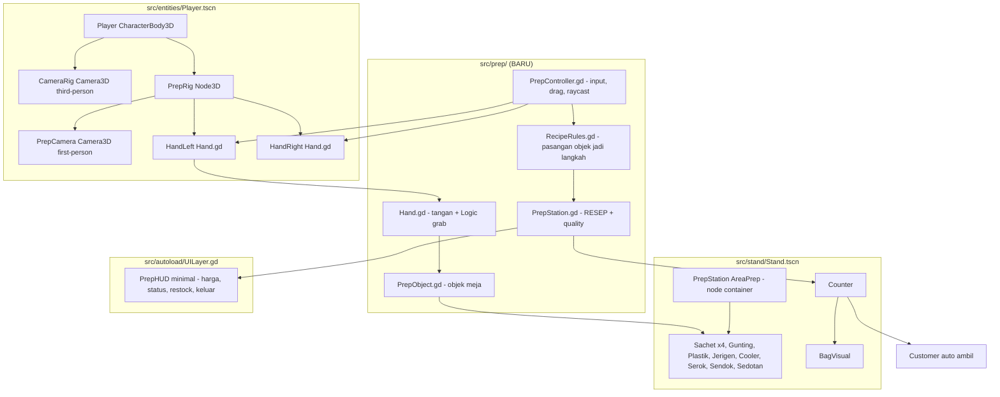

# Task 15 — First-Person Hands: membuat es cekek secara fisik (bukan panel abstrak)

> Status: **SELESAI (T0–T14) — 2026-10-22.** Semua keputusan di bawah sudah dikonfirmasi user.
> Verifikasi: `scripts\run_tests.cmd --boot` → **314/314 cek lolos, 0 gagal, boot bersih**.
> T14 (re-export 4 build) **sudah selesai** via `run.bat --build` (4 preset sukses, `.exe` boot bersih, `.apk` signed).
> **Task 16 (kontrol layar sentuh) — SELESAI (T16–T17), 2026-10-22 → 346/346 cek lolos.**
> Ringkasan & hasil ada di `context.md` §13.
> Sumber: `context.md`, `todo.md`, `AGENTS.md`, `1792500018425-es-cekek-mvp-plan.md`.

---

## 0. Masalah & keputusan user

**Masalah:** core gameplay sekarang "mismatch". Loop pembuatan es = klik tombol di panel 2D
(`ACTION_BRAND_SELECT` → `ACTION_VOLUME_INC` → `ACTION_WATER` → `ACTION_STIR` →
`ACTION_ICE_INC` → `ACTION_STRAW` → `ACTION_BUILD`). Tidak ada interaksi fisik apa pun.

**Target:** interaksi dengan meja → **view berubah jadi first-person dengan dua tangan
(kanan & kiri)**. Semua kebutuhan pembuatan es diambil **manual dengan mouse + drag**,
seperti di dunia nyata:

> ambil sachet di tangan kiri → tangan kanan ambil gunting → gunting memotong sachet →
> gunting diletakkan → tangan yang free ambil plastik → serbuk sachet dimasukkan ke plastik →
> air → aduk → es → sedotan → es cekek siap → pelanggan auto ambil.

**Keputusan yang sudah dikonfirmasi user (5):**

| # | Keputusan | Isi |
|---|---|---|
| 1 | Panel prep lama | **DIHAPUS total.** Semua langkah hanya lewat drag objek 3D. Digantikan HUD minimal (harga + status pesanan + tombol). |
| 2 | Set objek | 4 sachet (1 per brand) + GUNTING + TUMPUK PLASTIK + JERIGEN AIR + COOLER ES + SEROK + SENDOK ADUK + SEDOTAN. |
| 3 | Resep | Wajib berurutan: gunting→potong sachet → serbuk ke plastik → air → aduk → es (serok) → sedotan. Quality = kelengkapan + urutan. |
| 4 | Penyerahan | Tas **dibawa/drag ke pelanggan**; kalau es sudah siap, **pelanggan auto ambil** (tidak perlu klik tambahan). |
| 5 | Kontrol | Mouse gerak (tanpa tombol) = **lihat** (pitch ±35°, yaw ±60°, putar badan 180° dengan `R`); klik-tahan-kiri di objek = **ambil** dengan tangan terdekat (`Q` = tukar tangan); geser = gerakkan; lepas/klik-kanan = **letakkan**. Touch: 1 jari di objek = ambil, 1 jari di area kosong = lihat, 2 jari = look. |

**Tambahan user (6):** kalau tas belum siap dan dibawa ke pelanggan, pelanggan **komplain
spesifik** — "ini belum dikasih air", "kurang es", dst — sesuai objek/langkah yang kurang.

---

## 1. Dampak ke keputusan & tuning yang sudah ada (WAJIB ditulis eksplisit)

`AGENTS.md` melarang mengubah Implementer Decision / tuning tanpa menyatakan eksplisit.
Perubahan ini **menyentuh Decision #1 dan quality formula**, jadi dicatat di sini:

| Item | Sebelum | Sesudah | Alasan |
|---|---|---|---|
| Decision #1 (konsumsi bahan) | sachet + es dikonsumsi saat **Bag di-build** | **Sama** — bahan tetap dikonsumsi saat tas selesai dibuat, bukan saat diambil dari rak | keputusan user tidak menyentuh ini; konsistensi dengan "salah brand tetap dibuang" |
| "NO minigame" (deskripsi MVP plan) | loop abstrak berbasis tombol | loop **direct physical manipulation** (bukan minigame terpisah: tidak ada timing bar, tidak ada mode layar terpisah) | ini **perubahan falsesafe**: tetap 1 mode, tidak ada minigame; fisika = alat, bukan minigame |
| Bobot kualitas | `W_VOLUME .25 / W_WATER .20 / W_STIR .20 / W_ICE .25 / W_STRAW .10` | **SAMA persis** | tuning table tidak berubah; `prep_quality = base_quality × step_score × tool_mod × 100` tetap |
| `IDEAL_ICE_MIN 2 / IDEAL_ICE_MAX 6` | 2..6 sendok es = "well iced" | **SAMA**; 1 serok = 2.sendok → 1..3 serok = 2..6 sendok | konstanta tidak berubah, hanya cara menyebutnya |
| `MAX_SPOON_ICE 8`, `ICE_COST_PER_SPOON 0.2` | — | **SAMA** | — |
| `PREP_PANEL` di `UILayer` | tombol brand/volume/air/aduk/es/sedotan | **DIHAPUS**; digantikan HUD minimal | keputusan user #1 |
| `PrepStation.pour/add_water/stir/add_ice/add_straw` | dipanggil dari tombol UI | dipanggil dari **rule fisika** (`RecipeRules`) | API tetap, pemanggil berubah → test lama masih bisa dipakai |

**Baru (tuning baru, sudah masuk tabel tuning `context.md` §8):**

| Parameter | Nilai | Arti |
|---|---|---|
| `Hand.reach_radius` | 0.45 m | radius jangkauan tangan untuk interaksi dua tangan |
| `RecipeRules.INTERACT_DIST` | 0.28 m | jarak dua tangan untuk memicu aksi (potong, tuang, aduk) |
| `PrepController.work_plane_y()` | tinggi meja | bidang kerja tempat objek di-drag dilepas |
| `RecipeRules.SCOOP_SPOONS` | 2 | 1 serok = 2 sendok es |
| `PrepStation.OUT_OF_ORDER_PENALTY` | ×0.70 per langkah terbalik | penalti quality kalau langkah berurutan dilanggar |
| `PrepController.REACH` | 2.2 m (Task 16; semula 1.30) | jangkauan ray-pick objek dari kamera prep — harus mencakup seluruh lebar meja 2,36 m |
| `PrepController.CUSTOMER_TAKE_DIST` | 1.60 m | jarak pelanggan ke konter untuk auto-take / komplain |
| `PrepController.COMPLAIN_COOLDOWN` | 4.0 s | jeda antar komplain pelanggan |
| `Player.EYE_HEIGHT` | 1.6 m | tinggi mata di mode first-person |
| `Player.PREP_STAND_OFFSET` | 1.5 m (Task 16; semula 1.05) | jarak pemain dari konter saat mode prep — 1,05 m membuat ujung meja jatuh di luar layar |
| `Player.PREP_START_PITCH` | -25° (Task 16, baru) | kemiringan pandang awal di meja — meja langsung terlihat tanpa harus menggerakkan mouse dulu |
| `Player.TOUCH_LOOK_SENS_SCALE` | 1.0 (Task 16) | pengali sensitivitas look untuk layar sentuh — knob tuning "feel" |
| `Player.TOUCH_MOUSE_SLOP` | 48 px (Task 16) | toleransi takeover mouse-tiruan ↔ jari asli |
| `Player.LOOK_PITCH_LIMIT` / `LOOK_YAW_LIMIT` | 35° / 60° | batas gerakan pandang |
| `Player.LOOK_SENS` | 0.22 | sensitivitas mouse (derajat per piksel) |
| `Player.TURN_BODY_SPEED` | 90 °/s | kecepatan memutar badan (tombol `R`) |
| ~~`PICK_MISS`~~ | — | **tidak dipakai** — objek di-pick lewat ray ke `Area3D`, bukan toleransi jarak tetap |

---

## 2. Arsitektur baru



### 2.1 File BARU (`src/prep/`)

| File | Tanggung jawab | API kunci |
|---|---|---|
| `src/prep/PrepObject.gd` | Base class semua objek meja | `kind: int` (enum `SACHET/SCISSORS/PLASTIC_BAG/WATER/ICE_COOLER/ICE_SCOOP/SPOON/STRAW`), `brand: SachetBrand`, `held_by: Hand`, `is_cut`, `has_powder`, `water_level`, `is_stirred`, `ice_spoons`, `has_straw`, `can_hold()`, `grab(hand)`, `release()`, `reset_to_table()` |
| `src/prep/Hand.gd` | Tangan kiri/kanan | `side: int` (`LEFT/RIGHT`), `holds: PrepObject`, `is_free()`, `grab(obj)`, `release()`, `grip_position() -> Vector3`, `reach_radius` |
| `src/prep/RecipeRules.gd` | Memetakan **pasangan objek** → **langkah resep** | `evaluate(left: PrepObject, right: PrepObject) -> StringName` mengembalikan `&"cut"`, `&"pour_powder"`, `&"pour_water"`, `&"stir"`, `&"add_ice"`, `&"add_straw"` atau `&""`; `missing_steps(session) -> Array[String]` (pesan komplain Indonesia) |
| `src/prep/PrepController.gd` | Orkestrasi: input mouse/touch, raycast, drag, work plane,uuids | `enter_prep(stand)`, `exit_prep()`, `state`, `_process()` look/drag, `active_hand()`, `swap_hand()` |

### 2.2 File yang DIUBAH

| File | Perubahan |
|---|---|
| `src/entities/Player.tscn` | Tambah `PrepRig` (Node3D) → `PrepCamera` (Camera3D, `current=false`), `HandLeft`, `HandRight` (Node3D + `Hand.gd`). `Camera3D` third-person tetap. |
| `src/entities/Player.gd` | Tambah `State.PREP`; `interact` di meja → masuk PREP (bukan buka panel); `E`/`Esc` keluar; look mouse; sembunyikan `Body` di PREP. |
| `src/stand/PrepStation.tscn` | Jadi **container area prep fisik**: `SachetRack` (4 sachet), `Scissors`, `PlasticStack`, `WaterJug`, `IceCooler`, `IceScoop`, `Spoon`, `StrawHolder`, `WorkPlane` (marker tinggi meja). Node lama (Rack/Barrel/Carton/SodaCan) digantikan. |
| `src/stand/PrepStation.gd` | Jadi **mesin state resep** (nama class dipertahankan agar test & tuning tidak putus): tambah `record_step(step)`, `step_history: Array[StringName]`, `missing_steps()`, `out_of_order_penalty`; `pour/add_water/stir/add_ice/add_straw` tetap ada tapi dipanggil dari `RecipeRules`; `build_bag()` tetap (konsumsi Inventory); `snapshot()` tambah `steps_done`, `missing`. |
| `src/stand/Stand.gd` | `interact_at_stand()` → masuk mode PREP (bukan `UILayer.show_prep_panel`); `close_prep()` → keluar PREP; hapus routing `_on_prep_action` untuk langkah (sisakan `ACTION_PRICE_*` + `ACTION_RESTOCK_*` + `ACTION_SERVE`); `offer_bag()` dipanggil dari `PrepController` saat resep selesai. |
| `src/entities/Customer.gd` | Tambah `take_bag(bag) -> Dictionary` (ambil tas dari konter) + `complain_missing(lines)`; `evaluate_serve` dipakai apa adanya. |
| `src/autoload/UILayer.gd` | **Hapus** `_build_prep_panel()` + tombol brand/volume/air/aduk/es/sedotan + `update_prep`; ganti **`PrepHUD`** minimal: `Harga` (slider desktop / tombol ± 48dp untuk touch), `Status` (langkah yang kurang), `Beli Sachet`, `Beli Es`, `Keluar`. |
| `src/autoload/InputSetup.gd` | Tambah action: `swap_hand` (Q), `prep_exit` (E / Esc), `turn_body` (R). Hapus `pour/add_water/stir/add_ice/add_straw` dari keyboard binding (tetap ada sebagai action agar tidak break, tapi tidak dipakai) — atau dibuang bersih; **keputusan: dibuang** dari InputMap + `Project` tetap kompatibel karena `PrepStation` tidak lagi membaca InputMap. |
| `tests/runtime_test.gd` | Uji lama yang menyentuh panel prep di-replace; tambah asersi baru untuk loop fisik. |

### 2.3 Pemetaan mesh Kenney (CC0)

| Objek | Mesh | Catatan |
|---|---|---|
| Sachet (4 brand) | `food/bag-flat.glb` | 4 instans, `color_tint` per brand |
| Gunting | **tidak ada** di pack | fallback: `food/cooking-knife.glb` sebagai proxy "pisau cutter", **atau** mesh gunting prosedural (2 blade + 2 handle dari BoxMesh). → **butuh keputusan implementer** (default: mesh prosedural, nama tetap "Gunting") |
| Tumpuk plastik | `food/bag-flat.glb` (stack) | |
| Plastik (yang diisi) | `food/bag.glb` | |
| Jerigen air | `food/carton.glb` | sudah dipakai sebagai dispenser air |
| Cooler es | `food/barrel.glb` | sudah dipakai |
| Serok es | `food/bowl.glb` | mangkuk = serok |
| Sendok aduk | `food/cooking-spoon.glb` | |
| Sedotan | `food/chopstick.glb` | 1 batang = sedotan |
| Talenan | `food/cutting-board.glb` | tetap ada sebagai alas kerja |

---

## 3. Detail tiap langkah (urutan implementasi)

### Step 1 — `PrepObject` + `Hand` (dasar)
- `PrepObject` = `Node3D` + `MeshInstance3D` anak + `Area3D` (kotak) untuk picking.
- `Hand` menyimpan `holds`; `grab()` mereparent objek ke node tangan (atau Set `global_transform` tiap frame — **pakai reparent** supaya rotasi ikut).
- **Aturan tangan (sesuai user):** saat klik objek → hitung jarak objek ke `grip_position()` tiap tangan → pilih yang **paling dekat**; kalau tangan itu penuh → pakai tangan lain yang free; kalau dua-duanya penuh → pesan "Kedua tangan penuh".
- `Q` = `swap_hand()` →-next grab dipaksa ke tangan lain (untuk kasus "sachet di kiri, gunting di kanan").

### Step 2 — `PrepController` + first-person
- `enter_prep(stand)`: simpan stand, aktifkan `PrepRig` di posisi service, `PrepCamera.current = true`, `Camera3D` third-person `current = false`, `Body.visible = false`, `Player.state = PREP`, mouse mode **captured** untuk look? → **tidak**: mouse tetap terlihat (kursor = reticle), look cukup dari gerak mouse relatif (delta-event based), **tidak** `MOUSE_MODE_CAPTURED` → kursor tetap bisa diarahkan ke objek. Ini penting: user butuh mouse **drag** ke objek, jadi kursor harus terlihat.
- Look: `InputEventMouseMotion` **tanpa tombol ditekan** → yaw/pitch `PrepRig` (pitch clamp ±35°, yaw clamp ±60° relatif badan; `R` = putar badan 180°).
- Drag: `InputEventMouseButton` kiri **pressed** → raycast dari posisi kursor (`camera.project_ray_origin/normal`) → objek pertama yang kena (`collide_with_areas = true`, mask khusus) → grab; **drag** →|kursor| diproyeksikan ke **work plane** (bidang horizontal y = `WORK_PLANE_Y`) → titik target → tangan lerp ke titik itu (bukan teleport: `lerp`/`move_toward` dengan kecepatan)`; **released** → taruh objek: kalau di atas area meja → taruh (snap ke `y = 0.92`), kalau tidak → kembali ke posisi semula.
- `Esc`/`E` → `exit_prep()`.

### Step 3 — `RecipeRules` (fisika → langkah)
Pasangan objek dievaluasi **terus-menerus** selama drag (jarak antar-grip < `HAND_INTERACT_DIST`):

| Langkah | Pemicu | Efek |
|---|---|---|
| `cut` | gunting + sachet (apa pun sisi) | sachet `is_cut = true`; brand sachet → `session.brand`; bunyi `pour`/SFX baru `cut` |
| `pour_powder` | sachet terpotong + plastik (di tangan lain atau di meja) | plastik `has_powder = true`; `session.volume = MAX_VOLUME`; bunyi `pour` |
| `pour_water` | jerigen + plastik | plastik `water_level = 1.0`; `session.has_water = true`; bunyi `water` |
| `stir` | sendok + plastik (ada isi) | plastik `is_stirred = true`; bunyi `stir` |
| `add_ice` | serok + cooler → serok terisi (2 sendok); serok + plastik → es masuk | `session.ice_amount += SCOOP_SPOONS` (cap `MAX_SPOON_ICE`); bunyi `ice` |
| `add_straw` | sedotan + plastik | `session.has_straw = true`; bunyi `straw` |

- Urutan dijaga: `PrepStation.record_step(step)` mengecek `step_history` → kalau langkah mendahului langkah wajib sebelumnya → tandai `out_of_order` → penalti `×0.70` per langkah terbalik + pesan HUD "Urutan salah! Harusnya air dulu.".
- `missing_steps()` → `Array[String]`: `"Belum dipotong sachet!"`, `"Belum ada serbubnya!"`, `"Belum dikasih air!"`, `"Belum diaduk!"`, `"Belum ada es!"`, `"Belum ada sedotannya!"` → dipakai untuk komplain pelanggan.

### Step 4 — Tas jadi & pelanggan auto ambil
- Semua 6 langkah terpenuhi → `PrepStation.state = READY` → `build_bag()` (konsumsi 1 sachet brand terpilih + es dari `Inventory` — Decision #1) → `Stand.offer_bag(bag)` → `BagVisual` muncul (Shell/Liquid/Straw, warna brand) → HUD menampilkan "Siap saji".
- Pelanggan auto ambil: saat **tas yang sedang dipegang tangan** (atau tas di konter) berada dalam jangkauan pelanggan:
  - `bag.state == READY` → `Customer.take_bag(bag)` → `Stand.serve_to(customer, bag)` (jalur ekonomi lama, tidak berubah) → `served` → uang masuk.
  - `bag.state != READY` → `Customer.complain_missing(missing_lines)` → bubble 3D + SFX `complain` + HUD menampilkan daftar yang kurang. Tas **tidak** hangus (bahan belum dikonsumsi karena Decision #1) → pemain bisa melanjutkan.

### Step 5 — HUD minimal
```
PrepHUD (Control, di atas game)
├── Harga   : Rp 3.000  [slider desktop | tombol − + 48dp untuk touch]
├── Status  : "Kurang: air, es"          (hijau kalau lengkap)
├── Order   : "Tejus • menunggu"          (dari order queue yang sudah ada)
├── [Beli Sachet] [Beli Es]              (48dp)
└── [Keluar dari meja]                    (48dp)
```
- Semua tombol `≥ 48dp` (rule `AGENTS.md`).
- `ACTION_PRICE_SET/INC/DEC`, `ACTION_RESTOCK_SACHET/ICE` tetap dipakai → jalur harga & restock **tidak berubah** (`Stand._set_price`, `Stand._restock_sachet`).

### Step 6 — Test & dokumen
- Test baru (asersi headless): hand nearest-pick, swap hand, dua tangan penuh, setiap aturan `RecipeRules` (cut/pour/water/stir/ice/straw), urutan terbalik → penalti, `missing_steps()` isi, build bag konsumsi inventory (Decision #1), auto-take pelanggan + komplain "kurang apa", PrepHUD ada & tombol 48dp, PrepObject/Hand node ada di scene.
- Test lama yang menyentuh `UILayer.show_prep_panel` / `update_prep` → di-replace (bukan dihapus, biar coverage tidak turun).
- `context.md` §3/§5/§8/§10/§11/§12/§13 + `todo.md` (kotak + Session Log) di-update.

---

## 4. Risiko & mitigasi

| # | Risiko | Mitigasi |
|---|---|---|
| 1 | Look mouse vs drag mouse saling tumpang tindih | Look hanya saat **tidak ada tombol ditekan**; dragdominates saat tombol kiri ditekan. `MOUSE_MODE_CAPTURED` **tidak** dipakai (kursor harus terlihat untuk aim). |
| 2 | Objek "terluncur" saat drag (ray paralel work plane) | Kursor diproyeksikan ke work plane; kalau sudut terlalu datar → fallback ke jarak tetap 0,5 m di depan kamera. |
| 3 | Test lama (246 asersi) menyentuh panel prep → suite merah | Grep semua pemakaian `show_prep_panel`, `update_prep`, `ACTION_BRAND_SELECT` sebelum coding; ganti per satuan kerja. |
| 4 | `Camera3D.current` ganda (third + first) → layar hitam | Pastikan hanya satu `current = true` pada setiap transisi; asersi regresi. |
| 5 | Auto-take pelanggan terlalu agresif (tas belum jadi langsung diambil) | Jangkauan kecil (0,6 m) + hanya saat tas dipegang tangan atau di konter; tas belum READY → komplain, bukan taken. |
| 6 | Mesh gunting tidak ada di Kenney | Mesh gunting prosedural (BoxMesh) — kecil, 1 file, tidak menambah dependensi. |
| 7 | 4 sachet per brand harus sinkron dengan `Inventory.sachet_stock` | `PrepController` refresh rack saat `Inventory.stock_changed` → sachet habis → sachet hilang dari rak (bisa di-restock). |

---

## 5. Acceptance Criteria (semua harus hijau)

1. [x] Interaksi dengan konter → **view first-person**, dua tangan terlihat, body pemain disembunyikan.
2. [x] `Esc`/`E` → kembali ke mode roam (third-person), walk & joystick tetap normal.
3. [x] 8 objek fisik ada di meja dan bisa **diambil** (tangan terdekat) + **diletakkan** kembali.
4. [x] **Tidak ada** tombol UI untuk langkah pembuatan es (brand/volume/air/aduk/es/sedotan) — semua harus lewat drag.
5. [x] Resep bisa diselesaikan hanya dengan urutan: gunting→potong → serbuk→plastik → air → aduk → es(serok) → sedotan.
6. [x] Melewati urutan → quality kena penalti + pesan HUD.
7. [x] Tas jadi → pelanggan di area jangkauan **auto ambil** → uang masuk via `Economy`/`Inventory` (jalur lama utuh).
8. [x] Tas belum jadi → pelanggan **komplain spesifik** ("Belum dikasih air!", "Kurang es!") + bubble 3D.
9. [x] Harga masih bisa diatur (slider desktop / tombol ± touch) & harga tidak bisa < cost.
10. [x] Restock sachet & es masih bisa dari HUD.
11. [x] `scripts\run_tests.cmd --boot` → **semua asersi hijau, boot bersih** (hasil nyata: **314/314 cek lolos, 0 gagal** — 246 asersi lama direvisi + 68 asersi Task 15).
12. [x] `context.md` + `todo.md` + `Readme.md` tersinkron (termasuk tabel tuning baru & catatan perubahan Decision).

### 5b. Acceptance Criteria Task 16 — kontrol layar sentuh

13. [x] Mouse **dan** multi-jari berbagi **satu** mesin state pointer (`Player.handle_prep_pointer`).
14. [x] 1 jari di objek → **ambil** (tangan terdekat); 1 jari di area kosong → **lihat**; 2 jari → **lihat**.
15. [x] Geser jari saat objek dipegang → objek ikut bergerak, pandangan **tidak** ikut berputar.
16. [x] Takeover **mouse tiruan → jari** (Android mengirim mouse tiruan sebelum event sentuh asli).
17. [x] Tombol layar **"Tukar Tangan"** (pengganti `Q`) & **"Putar Badan"** (pengganti `R`) benar-benar mengubah keadaan.
18. [x] **Seluruh objek meja masuk layar first-person** dan bisa di-ray-pick (fix geometri kamera:
      `PREP_STAND_OFFSET` 1,5 + `PREP_START_PITCH` -25° + `REACH` 2,2).
19. [x] `scripts\run_tests.cmd` → **346/346 cek lolos, 0 gagal**.
20. [ ] **"Feel" di perangkat diverifikasi manual oleh user** (TUGAS MANUAL T18 — lihat `todo.md`).

---

## 6. Urutan kerja (todo list)

- [x] **T0** Finalisasi arsitektur & keputusan (dokumen ini)
- [x] **T1** `src/prep/PrepObject.gd` + `src/prep/Hand.gd` + scene nodes
- [x] **T2** `src/entities/Player.tscn` + `Player.gd` → `State.PREP`, `PrepRig`, `PrepCamera`, look mouse, `R` putar badan
- [x] **T3** `src/prep/PrepController.gd` → raycast, drag, work plane, grab/drop, aturan tangan terdekat + `Q` swap
- [x] **T4** `src/stand/PrepStation.tscn` → layout objek fisik (4 sachet + 7 alat)
- [x] **T5** `src/prep/RecipeRules.gd` → 6 aturan interaksi + `missing_steps()`
- [x] **T6** `PrepStation.gd` → `record_step`, `step_history`, penalti urutan, `build_bag` tetap
- [x] **T7** `Stand.gd` → `interact_at_stand` masuk PREP, `offer_bag` dari controller, buang routing tombol langkah
- [x] **T8** `Customer.gd` → `take_bag()` + `complain_missing()` + auto-take
- [x] **T9** `UILayer.gd` → hapus panel prep lama, bangun `PrepHUD` minimal (harga, status, restock, keluar)
- [x] **T10** `InputSetup.gd` → `swap_hand` (Q), `prep_exit` (E/Esc), `turn_body` (R); hapus binding langkah lama
- [x] **T11** `tests/runtime_test.gd` → revisi asersi lama + asersi baru
- [x] **T12** `scripts\run_tests.cmd --boot` → hijau + boot bersih
- [x] **T13** `context.md` + `todo.md` + `Readme.md` sinkron
- [x] **T14** export ulang 4 build → `run.bat --build` (Windows/Linux/macOS/Android, `.apk` signed)
- [x] **T16** kontrol layar sentuh: `project.godot` (emulasi), `Player.handle_prep_pointer`,
      `PrepController.begin_drag_at/set_pointer/end_drag_at`, `UILayer` tombol TUKAR/PUTAR,
      fix geometri kamera (`PREP_STAND_OFFSET`, `PREP_START_PITCH`, `REACH`)
- [x] **T17** `_test_task16()` (8 blok asersi A–H) → **346/346 hijau**
- [x] **T18a** alat ukur sementara (`tools/input_probe.*`) dihapus; `todo.md` dapat bagian
      **✍️ TUGAS MANUAL** untuk user
- [ ] **T18b** QA perangkat → **TUGAS MANUAL user** (feel sentuh)
- [ ] **T19** commit ke git

---

## 7. Di luar scope (deferred)

- Solver IK lengan (tangan berupa mesh sederhana dulu, tanpa lengan penuh).
- Kode-linker physics (`PhysicsBody` untuk vkontur tangan).
- Multi-sachet per cups (1 sachet per tas dulu).
- Level detail mesh gunting realistis.
- Re-export 4 build → task terpisah setelah stabil.
